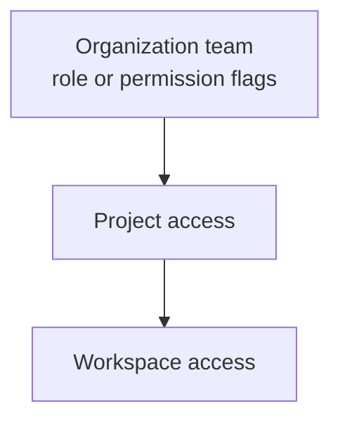
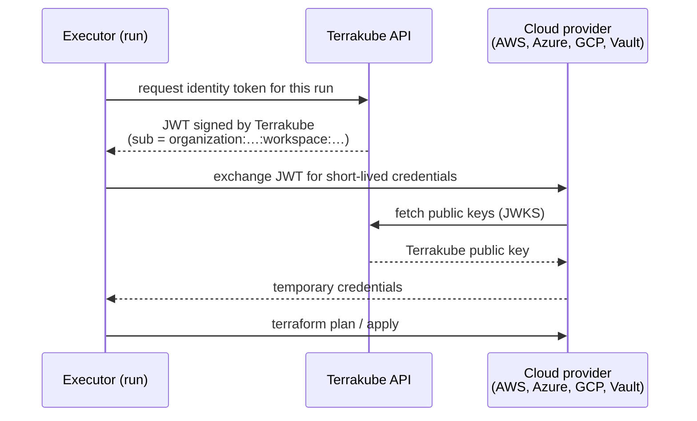
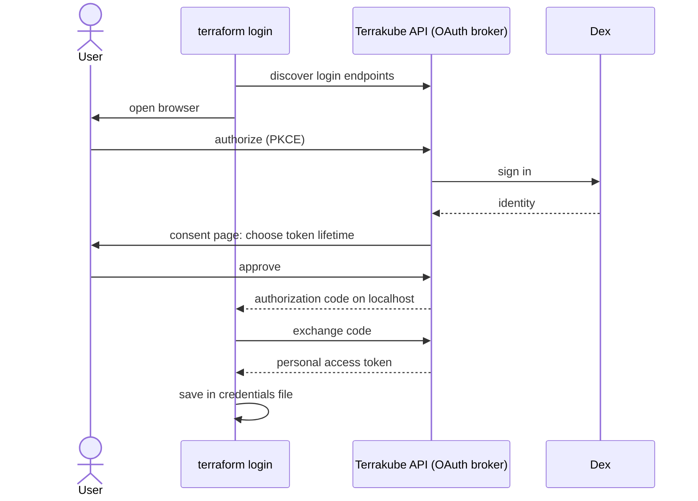

# Identity and Access

Terrakube separates **who you are** (authentication) from **what you can do** (authorization).

### Who can sign in

| Method | Use it for | Page |
| --- | --- | --- |
| Single sign-on through Dex | People using the UI | [User Management](../getting-started/user-management/README.md) |
| Personal access token | A person's CLI or scripts. Inherits that user's permissions | [API Tokens](../user-guide/organizations/api-tokens.md) |
| Team token | Shared automation. Inherits the team's permissions | [API Tokens](../user-guide/organizations/api-tokens.md) |
| `terraform login` | The Terraform CLI against the API and registry | [CLI-driven Workflow](../user-guide/workspaces/cli-driven-workflow.md#terraform-login) |
| Federated credential | CI jobs and workloads without a stored token | [Federated Identity](../user-guide/organizations/federated-identity.md) |

### What a user can do

Access is granted to **teams**, at three levels. A permission at a wider level applies to everything below it.

A team has a role (`admin`, `write`, `plan`, `read`) or, with the `custom` role, individual permissions such as managing state, modules, providers, VCS, templates or policies. See [Team Management](../user-guide/organizations/team-management.md), [Project Team Access](../user-guide/projects/team-access.md) and [Workspace Team Access](../user-guide/workspaces/team-access.md).

### How a run authenticates to your cloud

[Dynamic provider credentials](../user-guide/workspaces/dynamic-provider-credentials/README.md) let a run assume a cloud role without a stored secret.

The cloud provider trusts Terrakube's public key and matches claims such as the organization, workspace and project in its trust policy. Terrakube must therefore be reachable by the cloud provider on its public JWKS endpoints.

### How `terraform login` works

The token is a normal personal access token that you can delete from your user settings at any time.
