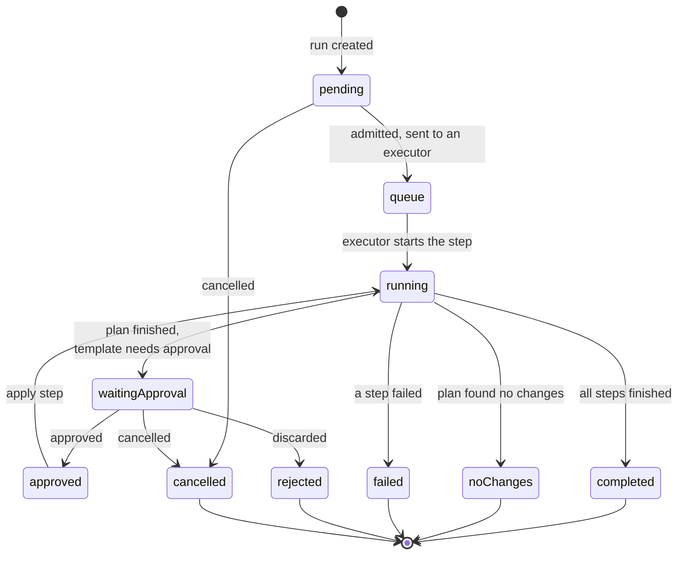
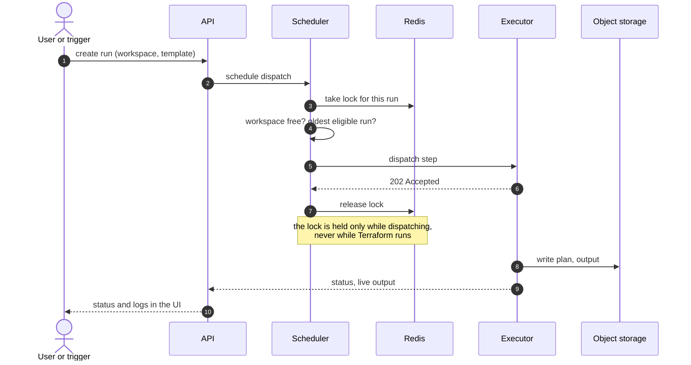
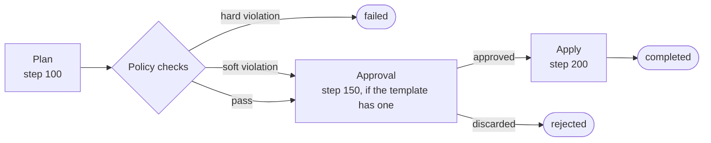

# Run Lifecycle

A **run** (a *job* in the API) is one execution of a [template](../user-guide/organizations/templates/README.md) against a workspace. It starts from the UI, a [VCS webhook](../user-guide/workspaces/webhooks.md), a [schedule](../user-guide/workspaces/workspace-scheduler.md), a [run trigger](../user-guide/workspaces/run-triggers.md), the [CLI](../user-guide/workspaces/cli-driven-workflow.md) or the [API](../user-guide/workspaces/api-driven-workflow.md).

### Status of a run

`pending`, `queue`, `running`, `approved` and `waitingApproval` are **active**: a workspace runs one job at a time, so later runs wait behind an active one. A run that is waiting for approval holds the workspace queue until someone approves, discards or cancels it.

### From click to plan

Two queues apply. Runs are serialized **per workspace**, and across the cluster they are admitted in **first-in, first-out** order, so a busy workspace never lets a newer run overtake an older eligible one, and it does not block other workspaces. If no executor is ready, the run stays `pending` and is retried; it does not fail. Runs that stay open too long are closed by [run limits](../getting-started/deployment/executor-log-output.md#run-limits).

### Steps in a run

A template is a list of steps. The common *Plan and Apply* template is:

Each step runs in a **fresh clone** of the repository, usually on a different executor. The apply step therefore applies the **saved plan** from the plan step. Files the plan built can be carried across with [plan artifacts](../user-guide/workspaces/plan-artifacts.md). The executor's working directory and extension handling are described in [Terraform Execution Flow](../user-guide/reference/executor/terraform-execution-flow.md).

### Output and state

* **State** is written to your storage backend through the backend configuration Terrakube generates for each run. See [Terraform State](../user-guide/workspaces/terraform-state.md).
* **Logs** stream live through Redis while a step runs and are saved to storage when it ends. Final structured results survive an API outage. See [Job Output](../user-guide/workspaces/job-output.md).
* **After an apply that changed state**, [run triggers](../user-guide/workspaces/run-triggers.md) queue runs in dependent workspaces and [notifications](../user-guide/workspaces/notifications.md) are sent.
