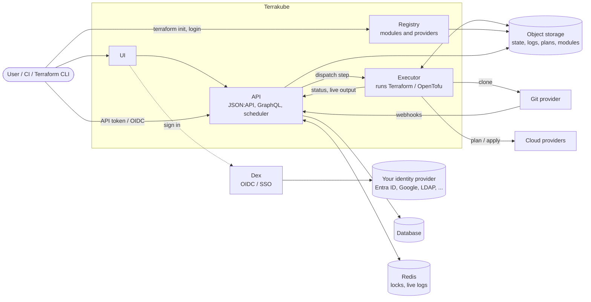

# Architecture

Terrakube is a small set of services around a relational database, object storage and an identity provider. You can run all of them in one Kubernetes cluster with the [Helm chart](deployment/helm-chart.md), or on a laptop with [Docker Compose](docker-compose.md).

### Components

| Component | What it does |
| --- | --- |
| **API** | The single source of truth. Exposes JSON:API and GraphQL for organizations, workspaces, jobs, teams, templates, modules and providers, enforces permissions, and runs the scheduler that dispatches jobs. |
| **Executor** | Runs the steps of a job (`terraform init/plan/apply`, scripts, policy checks) in a fresh working directory, then reports status and output back to the API. It can be a shared pool of pods, or an [ephemeral Kubernetes Job per run](deployment/ephemeral-agents.md). |
| **Registry** | A private Terraform registry for modules and providers, protected by the same login as the API. |
| **UI** | The web interface, a client of the API. |
| **Dex** | Handles sign-in and federates to your identity provider. See [User Management](user-management/README.md). |
| **Database** | Any database supported by Liquibase (PostgreSQL, MySQL, SQL Server, H2 for tests). |
| **Redis** | Distributed locks for the scheduler and the live log stream. Required when you run more than one API or executor replica. |
| **Object storage** | Terraform state, run output, saved plans and registry modules, on AWS S3, Azure Blob, Google Cloud Storage or a local volume. See [Storage backend](deployment/storage-backend/README.md). |

### Where to read next

* [Run lifecycle](../concepts/run-lifecycle.md): what happens between clicking **New Run** and an applied change.
* [Identity and access](../concepts/identity-and-access.md): how users, tokens, CI workloads and cloud providers authenticate.
* [Security](security.md): the security model.


The diagrams in this documentation are written in Mermaid. If your viewer shows them as plain code, open the page on GitHub, where they render.

