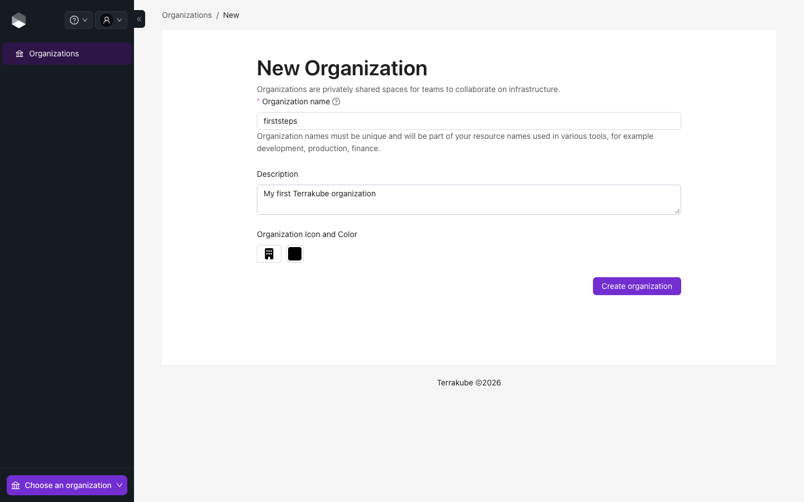
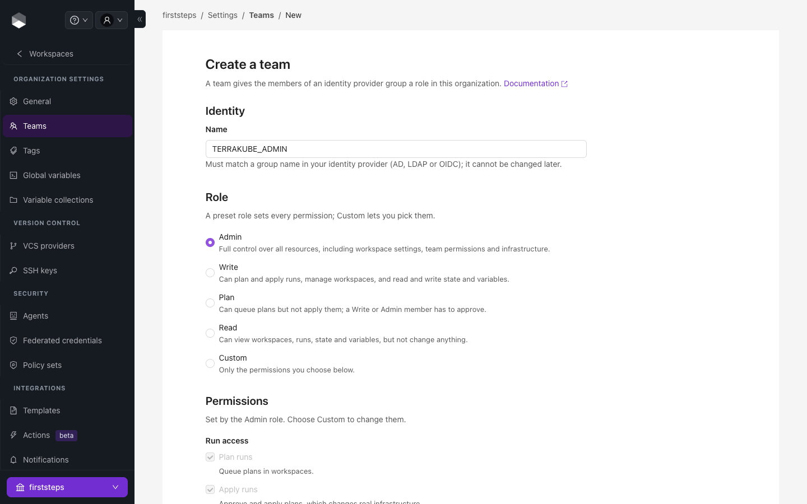
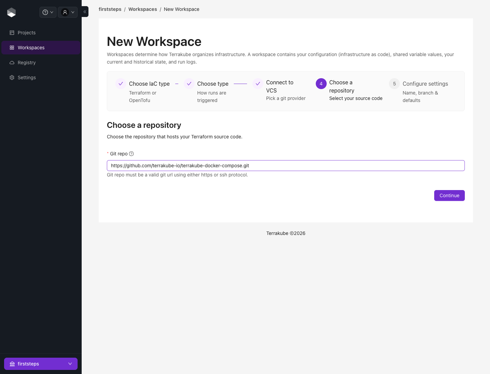
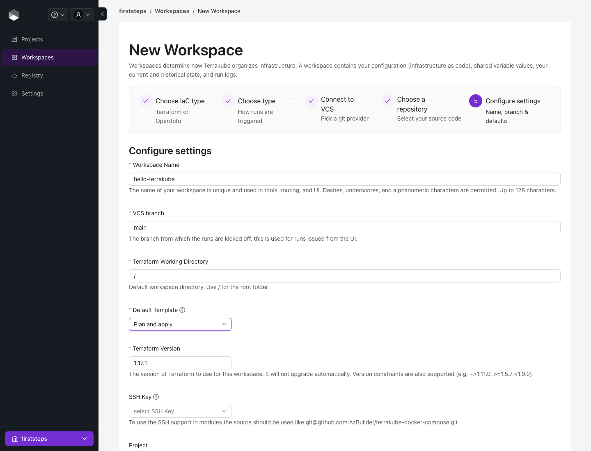
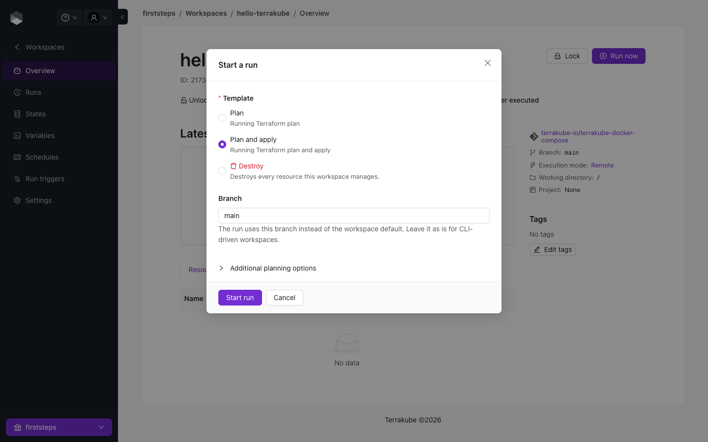
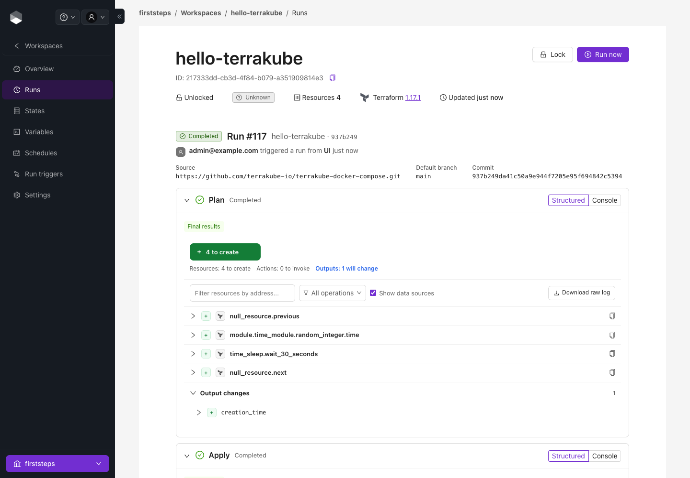
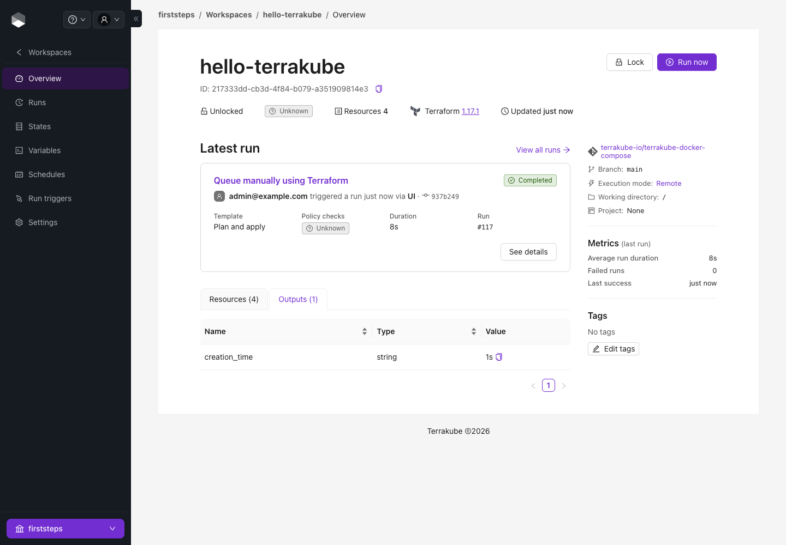

# Your First Run

This walks you from a fresh Terrakube to a finished, applied run in about ten minutes. It uses a public sample repository that creates only harmless `null`, `time` and `random` resources, so no cloud credentials are needed.

You need a running Terrakube ([Docker Compose](docker-compose.md) or [Minikube](deployment/minikube.md)) and a user in the administrator group. In the sandboxes that is `admin@example.com` with password `admin`.

### 1. Create an organization

An organization holds your teams, workspaces, registry and settings. Open **Organizations → Create organization**, enter a name and a description, and create it.

<figure><figcaption>
The New Organization form
</figcaption></figure>

Organization names can contain only **letters and numbers** (no spaces or hyphens). Only members of the administrator group can create organizations; see [Security](security.md#administrator-group).

### 2. Create a team

Terrakube gives access to **teams**, which match groups from your identity provider. Until a team exists you cannot create workspaces. After creating the organization you land on **Teams**: create one named exactly like your group, for example `TERRAKUBE_ADMIN`, with the **Admin** role.

<figure><figcaption>
Creating a team with the Admin role
</figcaption></figure>

The name must match the group name in your identity provider (case sensitive) because that is how Terrakube knows who belongs to the team. See [Team Management](../user-guide/organizations/team-management.md) for roles and custom permissions.

### 3. Create a workspace

A workspace is one Terraform configuration with its variables, state and runs. Open **Workspaces → New workspace** and answer the wizard:

1. **Choose IaC type:** Terraform.
2. **Choose type:** *Version control workflow*.
3. **Connect to VCS:** choose **Git**. This takes any `https` or `ssh` repository URL, so you do not need a VCS provider for a public repository. (To get automatic runs on every push, connect a [VCS provider](../user-guide/vcs-providers/README.md) later.)
4. **Choose a repository:** paste `https://github.com/terrakube-io/terrakube-docker-compose.git`.

<figure><figcaption>
Entering the Git repository URL
</figcaption></figure>

5. **Configure settings:** keep the workspace name or choose your own, set the **VCS branch** to `main` (it is required), keep the working directory `/`, and set **Default Template** to *Plan and Apply*. Then create the workspace.

<figure><figcaption>
Workspace settings
</figcaption></figure>

The new workspace has no runs yet. See [Creating Workspaces](../user-guide/workspaces/creating-workspaces.md) for the CLI-driven and API-driven workflows.

### 4. Start a run

Click **Run now**, keep the template **Plan and apply**, and click **Start run**.

<figure><figcaption>
The Start a run dialog
</figcaption></figure>

The run opens. Terrakube clones the repository, runs `terraform init` and `plan`, then applies. The **Structured** view shows each resource Terraform will change; **Console** shows the raw output.

<figure><figcaption>
A completed run
</figcaption></figure>

The first run downloads Terraform and the providers, so it takes a little longer than later runs. With the *Plan and apply* template the apply happens straight after the plan; use a template with an approval step when you want a person to review the plan first, as described in [Starting a Run](../user-guide/workspaces/starting-a-run.md#approve-or-discard-a-run).

### 5. See the result

Back on the workspace **Overview** you can see the run, the resources Terraform created, and the outputs. **States** lists every version of the state, each linked to the run that produced it.

<figure><figcaption>
The workspace overview
</figcaption></figure>

### Where to go next

| I want to... | Go to |
| --- | --- |
| Pass values to Terraform | [Variables](../user-guide/workspaces/variables.md), [Global Variables](../user-guide/organizations/global-variables.md) |
| Run automatically on every push or pull request | [VCS Providers](../user-guide/vcs-providers/README.md), [Webhooks](../user-guide/workspaces/webhooks.md) |
| Require approval, or enforce policy | [Starting a Run](../user-guide/workspaces/starting-a-run.md), [Policy Governance](../user-guide/policy-enforcement-opa.md) |
| Use my own cloud account safely | [Dynamic Provider Credentials](../user-guide/workspaces/dynamic-provider-credentials/README.md) |
| Run from the Terraform CLI or CI | [CLI-driven Workflow](../user-guide/workspaces/cli-driven-workflow.md), [CI/CD Integration](../user-guide/ci-cd-integration/README.md) |
| Chain workspaces | [Run Triggers](../user-guide/workspaces/run-triggers.md) |
| Understand what just happened | [Run Lifecycle](../concepts/run-lifecycle.md) |
