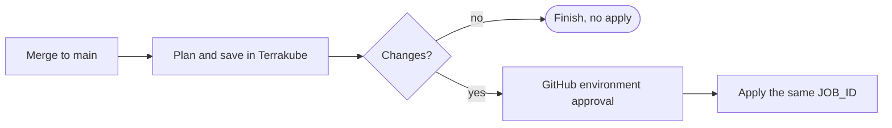

# GitHub Actions

There are three ways to run Terrakube from GitHub Actions. Pick the one that fits how you work:

| Approach | Best for |
| --- | --- |
| [Terrakube GitHub Action](#the-terrakube-github-action) | Plans on pull requests with results as comments, and applies on merge with GitHub environment approval, using OIDC. |
| [Terraform or OpenTofu CLI](#the-terraform-or-opentofu-cli) | You already run `terraform plan` and `apply` in a workflow and want the run to execute in Terrakube. |
| [Terrakube CLI](#the-terrakube-cli) | Scripting: trigger runs, and manage organizations, workspaces, variables and more. |

All three can use a Personal Access Token or team token stored as a secret. To avoid storing a long-lived token, use [Federated OIDC Authentication](federated-oidc-authentication.md).

### The Terrakube GitHub Action

[`terrakube-io/terrakube-action-github`](https://github.com/terrakube-io/terrakube-action-github) runs a Terrakube template from a workflow, waits for it, and reports back to GitHub with a pull request comment and a job summary. The Terraform or OpenTofu run itself still happens on the Terrakube executor, with your workspace's variables, credentials and policies.


**Version 2.0.0** targets **Terrakube 2.34.0 or later** and needs GitHub Actions runner **v2.327.1 or later** on self-hosted runners (it ships its own Node 24 runtime). If you run an older Terrakube, stay on a 1.x release of the action. Pin the action to a release tag, `@v2.0.0`, or to a full commit SHA for stronger supply-chain protection, and never to `@main`.


#### What it does

* **Authenticates** to Terrakube with GitHub OIDC (no stored secret) or a personal access token.
* **Chooses workspaces** from explicit folders, or discovers which folders changed in the pull request or push.
* **Runs a template** against an exact commit and checks that Terrakube ran that same revision.
* **Gives feedback:** a pull request comment with the structured plan, and a job summary.
* **Stages deployments.** It can plan, wait for **GitHub environment approval**, then apply that same saved plan, so what was reviewed is what is applied.
* **Forwards per-run variables** such as `TF_VAR_*` secrets without changing the workspace.

#### Plan on pull requests

This workflow plans a workspace for every pull request, using GitHub OIDC:

```yaml
name: Terrakube plan
on: pull_request

permissions:
  contents: read
  pull-requests: write
  id-token: write          # needed for OIDC

concurrency:
  group: terrakube-${{ github.event.pull_request.number }}
  cancel-in-progress: true

jobs:
  plan:
    if: github.event.pull_request.head.repo.full_name == github.repository   # skip fork PRs
    runs-on: ubuntu-latest
    timeout-minutes: 65
    steps:
      - uses: actions/checkout@v4
        with:
          ref: ${{ github.event.pull_request.head.sha }}
          persist-credentials: false

      - uses: terrakube-io/terrakube-action-github@v2.0.0
        with:
          TERRAKUBE_ENDPOINT: https://terrakube-api.example.com
          TERRAKUBE_ORGANIZATION: my-organization
          TERRAKUBE_TEMPLATE: Terraform-Plan
          TERRAKUBE_AUTH: oidc
          TERRAKUBE_OIDC_AUDIENCE: api://terrakube
          TERRAKUBE_ROOT: infrastructure/network
          TERRAKUBE_WORKSPACE: network
          TERRAKUBE_UI_URL: https://terrakube.example.com
```

`TERRAKUBE_TEMPLATE` is the name of a [template](../organizations/templates/README.md), here a plan-only one. To use a token instead of OIDC, set `TERRAKUBE_AUTH: token` and `TERRAKUBE_TOKEN: ${{ secrets.TERRAKUBE_PAT }}`, and drop `id-token: write`.

A plan template does **not** make the run read-only: the executor still holds the workspace's cloud credentials. Keep pull-request credentials separate from production credentials, and only run templates and code you trust with them.

#### Authenticate with GitHub OIDC

1. In the target organization, create a [team](../organizations/team-management.md) such as `github-actions-plan` with access to the workspace, permission to read the template, and permission to create and view plan runs.
2. A Terrakube superuser adds a [federated credential](../organizations/federated-identity.md) with **Team name** `github-actions-plan`, **Issuer URL** `https://token.actions.githubusercontent.com`, and **Audience** `api://terrakube` (the same value as `TERRAKUBE_OIDC_AUDIENCE`).
3. Add exact **claim conditions**, for example `repository` = `my-org/infrastructure` and `event_name` = `pull_request`. Federated trust is instance-wide, so keep conditions narrow.
4. Use a separate credential and team for deployments, restricted to the main branch and a protected environment (for example `sub` = `repo:my-org/infrastructure:environment:production`).

Tokens are renewed automatically before they expire. See [Federated Identity](../organizations/federated-identity.md) for how Terrakube maps claims to teams.

#### Choose which workspaces run

| You set | Result |
| --- | --- |
| `TERRAKUBE_ROOT` | Runs that folder (or several, one per line) regardless of changes. Use `.` for the repository root. An existing workspace needs no `terrakube.json`. |
| `TERRAKUBE_WORKSPACE` or `TERRAKUBE_WORKSPACE_ID` | The workspace to use. Needs exactly one root. |
| Neither | The action finds folders containing a `terrakube.json` and, on pull requests and pushes, runs only those with changed files. Use `fetch-depth: 0` on checkout. |

The workspace's repository and folder must match the workflow; the action does not rewrite workspace settings. By default **missing workspaces are not created**. Set `CREATE_WORKSPACE: 'true'` to create them from a `terrakube.json` in each root:

```json
{
  "workspace": "network",
  "terraform": "1.9.8",
  "iacType": "terraform"
}
```

`terraform` (the version) is required to create a workspace; `iacType` is `terraform` (default) or `tofu`. Existing workspaces keep their engine and version.

#### Plan, approve in GitHub, then apply

For deployments, plan the merged commit, let GitHub's environment protection approve it, then apply **the same saved plan**:



First create a dedicated template with a plan, an approval owned by the apply team, and a saved-plan apply:

```yaml
flow:
  - type: terraformPlan
    step: 100
  - type: approval
    step: 200
    team: github-actions-apply
  - type: terraformApply
    step: 300
    requireSavedPlan: true
```

The approval step holds the run until the GitHub-approved job releases it through the API, so there is no second human approval in Terrakube. Always name a `team` (without one, anyone who can read the run could approve it), keep the plan identity out of that team, and keep the template unchanged while plans are pending. See [Require a saved plan](../organizations/templates/README.md#require-a-saved-plan).

Then use two jobs in one workflow, passing the plan's `JOB_ID` to the apply:

```yaml
name: Terrakube deploy
on:
  push:
    branches: [main]

permissions:
  contents: read
  id-token: write

concurrency:
  group: terrakube-production
  cancel-in-progress: false

jobs:
  plan:
    runs-on: ubuntu-latest
    outputs:
      job-id: ${{ steps.terrakube.outputs.JOB_ID }}
      has-changes: ${{ steps.terrakube.outputs.HAS_CHANGES }}
    steps:
      - uses: actions/checkout@v4
        with:
          ref: ${{ github.sha }}
          persist-credentials: false
      - uses: terrakube-io/terrakube-action-github@v2.0.0
        id: terrakube
        with:
          TERRAKUBE_OPERATION: plan
          TERRAKUBE_ENDPOINT: https://terrakube-api.example.com
          TERRAKUBE_ORGANIZATION: my-organization
          TERRAKUBE_TEMPLATE: GitHub Plan and Apply
          TERRAKUBE_AUTH: oidc
          TERRAKUBE_OIDC_AUDIENCE: api://terrakube
          TERRAKUBE_ROOT: infrastructure/network
          TERRAKUBE_WORKSPACE: network
          TERRAKUBE_COMMIT: ${{ github.sha }}

  apply:
    needs: plan
    if: needs.plan.outputs.has-changes == 'true'
    runs-on: ubuntu-latest
    environment: production        # required reviewers are configured on this environment
    steps:
      - uses: actions/checkout@v4
        with:
          ref: ${{ github.sha }}
          persist-credentials: false
      - uses: terrakube-io/terrakube-action-github@v2.0.0
        with:
          TERRAKUBE_OPERATION: apply
          TERRAKUBE_JOB_ID: ${{ needs.plan.outputs.job-id }}
          TERRAKUBE_ENDPOINT: https://terrakube-api.example.com
          TERRAKUBE_ORGANIZATION: my-organization
          TERRAKUBE_TEMPLATE: GitHub Plan and Apply
          TERRAKUBE_AUTH: oidc
          TERRAKUBE_OIDC_AUDIENCE: api://terrakube
          TERRAKUBE_ROOT: infrastructure/network
          TERRAKUBE_WORKSPACE: network
          TERRAKUBE_COMMIT: ${{ github.sha }}
```

`TERRAKUBE_OPERATION` is `run` (default: run a template to completion), `plan` (stop at the approval gate, `STATUS: planned`), `apply` (release a saved plan by `TERRAKUBE_JOB_ID`) or `discard`. The staged operations need one explicit root, an existing workspace, a full commit SHA, and the **same template and commit** for the plan and the apply. Plan and apply should use different identities: map the apply team to a separate federated credential restricted to the main branch and the protected environment. A plan with no changes skips the apply (`HAS_CHANGES` is `false`).

#### Per-run variables

Forward Terraform variables for one run, for example secrets from GitHub, without storing them on the workspace:

```yaml
env:
  TF_VAR_db_password: ${{ secrets.DB_PASSWORD }}
  TF_VAR_region: ${{ vars.REGION }}
with:
  TERRAKUBE_VARIABLE_NAMES: |
    db_password
    region
```

List the names without the `TF_VAR_` prefix; only those leave the runner. This needs Terrakube 2.34 ([run-specific variables](../workspaces/api-driven-workflow.md#variables-for-one-run)), one explicit root and workspace, and **Manage workspace** permission for the identity. Supply them on `run` or `plan`; `apply` reuses the saved inputs. Mark secret variables `sensitive = true` in Terraform.

#### Pull request feedback

`COMMENT_MODE` controls the comment on the pull request: `summary` (default: status, revision, link and the structured plan), `full` (adds step logs) or `off`. The same plan is always written to the GitHub job summary. The action keeps one comment per workspace up to date and leaves other people's comments alone. `SHOW_OUTPUT` still works but is deprecated.

#### Inputs and outputs

| Input | Description | Default |
| --- | --- | --- |
| `TERRAKUBE_ENDPOINT` (required) | HTTPS URL of the Terrakube API. | |
| `TERRAKUBE_ORGANIZATION` (required) | Organization name. | |
| `TERRAKUBE_TEMPLATE` (required) | Template name. | |
| `TERRAKUBE_AUTH` | `token` or `oidc`. | `token` |
| `TERRAKUBE_TOKEN` | Personal access or team token, for `token` authentication. | |
| `TERRAKUBE_OIDC_AUDIENCE` | Audience of the federated credential, for `oidc`. | |
| `TERRAKUBE_OPERATION` | `run`, `plan`, `apply` or `discard`. | `run` |
| `TERRAKUBE_JOB_ID` | Existing run, for `apply` and `discard`. | |
| `TERRAKUBE_ROOT` | Folder(s) to run, one per line. | Change discovery |
| `TERRAKUBE_WORKSPACE` / `TERRAKUBE_WORKSPACE_ID` | Workspace name or id; needs one root. | `terrakube.json`, else the folder name |
| `TERRAKUBE_BRANCH` | Branch to run. | PR head branch or current ref |
| `TERRAKUBE_COMMIT` | Full commit SHA to run and verify. | PR head SHA or event SHA |
| `TERRAKUBE_VARIABLE_NAMES` | Variables to forward from `TF_VAR_<name>`. | |
| `CREATE_WORKSPACE` | Create missing workspaces from `terrakube.json`. | `false` |
| `TERRAKUBE_WORKSPACE_BRANCH` | Default branch of newly created workspaces. | Repository default |
| `TERRAKUBE_SSH_KEY_NAME` | Existing [SSH key](../vcs-providers/ssh.md) for workspace creation and private repositories. | |
| `APPROVAL_MODE` | `wait` for approval, or `fail` at an approval pause. | `wait` |
| `COMMENT_MODE` | `off`, `summary` or `full`. | `summary` |
| `TERRAKUBE_UI_URL` | UI URL, for links. | |
| `TIMEOUT_SECONDS`, `REQUEST_TIMEOUT_SECONDS`, `POLL_INTERVAL_SECONDS` | Run, request and polling limits. | `3600`, `30`, `5` |
| `GITHUB_TOKEN` | Token for pull request comments. | `${{ github.token }}` |
| `IGNORE_SSL_ERROR` | Skip TLS verification. Prefer `NODE_EXTRA_CA_CERTS` for a private CA. | `false` |

| Output | Description |
| --- | --- |
| `JOB_ID`, `JOB_IDS` | The submitted run id, or a JSON array of all ids. |
| `STATUS` | `running`, `planned`, `completed`, `failed` or `skipped`. |
| `HAS_CHANGES` | For `plan`: `true` when a plan is ready to apply, `false` for no changes. |
| `JOB_URL`, `JOBS` | A link to the run (with `TERRAKUBE_UI_URL`), and a JSON array of results. |

Stopping the workflow does **not** cancel the run in Terrakube. Keep the job ids from the outputs before retrying. The action's [README](https://github.com/terrakube-io/terrakube-action-github#readme) has the full reference.

#### Upgrading from 1.x

| 1.x | 2.0.0 |
| --- | --- |
| Not tied to a Terrakube version | Requires **Terrakube 2.34.0+** and runner v2.327.1+ |
| `TERRAKUBE_TOKEN` required | `TERRAKUBE_AUTH` chooses `token` or `oidc`; the token is optional |
| `SHOW_OUTPUT` | `COMMENT_MODE` (`SHOW_OUTPUT` is deprecated) |
| Creates a workspace for every folder with a `terrakube.json` | Does not create workspaces unless `CREATE_WORKSPACE: 'true'` |
| Runs a branch | Runs and verifies an exact commit |
| `uses: AzBuilder/terrakube-action-github@main` | `uses: terrakube-io/terrakube-action-github@v2.0.0` |
| Apply happens in the template | Optional staged `plan` then `apply` with GitHub approval |

Update `TERRAKUBE_ENDPOINT` to an HTTPS URL, switch to the new inputs, and test on a non-production workspace first.

### The Terraform or OpenTofu CLI

Terrakube works as a remote backend for the Terraform and OpenTofu CLI (the [CLI-driven workflow](../workspaces/cli-driven-workflow.md)), so a normal `terraform plan` or `apply` in a workflow can execute in Terrakube. Configure the `cloud` block as described there, then give the CLI a token:

```yaml
jobs:
  terraform:
    runs-on: ubuntu-latest
    steps:
      - uses: actions/checkout@v4

      - uses: hashicorp/setup-terraform@v3
        with:
          cli_config_credentials_hostname: terrakube-api.example.com
          cli_config_credentials_token: ${{ secrets.TERRAKUBE_PAT }}

      - run: terraform init
      - run: terraform plan
```

This keeps state, variables, policy checks and run history in Terrakube while the workflow stays in GitHub. For OpenTofu use `opentofu/setup-opentofu` the same way. If the registry has a different hostname from the API, add the token for both hostnames. See [CLI-driven Workflow](../workspaces/cli-driven-workflow.md).

### The Terrakube CLI

The [Terrakube CLI](../terrakube-cli/README.md) (`terrakube`) manages Terrakube itself and can trigger runs. Download a release binary ([releases](https://github.com/terrakube-io/terrakube-cli/releases)) and configure it with environment variables:

```yaml
jobs:
  run:
    runs-on: ubuntu-latest
    env:
      TERRAKUBE_API_URL: ${{ secrets.TERRAKUBE_ENDPOINT }}
      TERRAKUBE_TOKEN: ${{ secrets.TERRAKUBE_PAT }}
      TERRAKUBE_ORGANIZATION: my-organization
    steps:
      - name: Install the Terrakube CLI
        run: |
          VERSION=1.0.0-beta.11
          curl -sL "https://github.com/terrakube-io/terrakube-cli/releases/download/v${VERSION}/terrakube_${VERSION}_linux_amd64.tar.gz" | tar -xz
          sudo mv terrakube /usr/local/bin/

      - name: Start a plan
        run: terrakube job create --workspace my-workspace --command plan --output json
```

See [`job create`](../terrakube-cli/commands/job/create.md) and the other [commands](../terrakube-cli/commands/README.md).

### Other tools

Anything that can call HTTP can use the [API](../../api/getting-started.md) directly, and the [Terraform provider](https://registry.terraform.io/providers/terrakube-io/terrakube/latest/docs) manages Terrakube resources as code.
