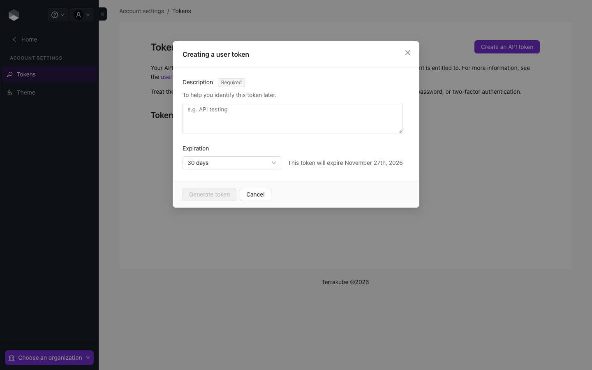

# API Tokens

Terrakube has two kinds of API tokens: user and team. Each token type has a different access level and creation process, which are explained below.

API tokens are only shown once when you create them, and then they are hidden. You have to make a new token if you lose the old one.

### Creation requirements in 2.34.0

Sign in through Dex to create personal or team tokens. Using an existing PAT, team token or federated token to create another token is refused by default. Administrators can permit bounded PAT-based issuance with `TokenAllowPatIssuance`; see [Token Security](../../getting-started/deployment/token-security.md#token-creation-and-lifetime).

Administrators can limit new token lifetimes with `TokenMaxDays`. Revoked or unknown Terrakube token IDs are rejected even if the JWT signature is valid. Team-token deletion requires membership in the token's group or instance-owner authorization.

### User API Tokens 

API tokens may belong directly to a user. User tokens inherit permissions from the user they are associated with.

User API tokens can be generated inside the **User Settings**.

<figure><figcaption>
Creating a user token
</figcaption></figure>

Click the **Generate and API token** button

Add some small description to the token and the duration

The new token will be showed and you can copy it to star calling the Terrakube API using Postman or some other tool.

#### Delete API Tokens 

To delete an API token, navigate to the list of tokens, click the **Delete** button next to the token you wish to remove, and confirm the deletion.

### Team API Tokens 

API tokens may belong to a specific team. Team API tokens allow access Terrakube, without being tied to any specific user.


A team token can only be generated if you are member of the specified team.


To manage the API token for a team, go to **Settings  > Teams > Edit button on the desired team**.

Click the **Create a Team Token** button in the Team API Tokens section.

Add the token description and duration and click the **Generate token** button

The new token will be showed and you can copy it to star calling the Terrakube API using Postman or some other tool.

#### Delete Team API Tokens 

To delete an API token, navigate to the list of tokens, click the **Delete** button next to the token you wish to remove, and confirm the deletion.

