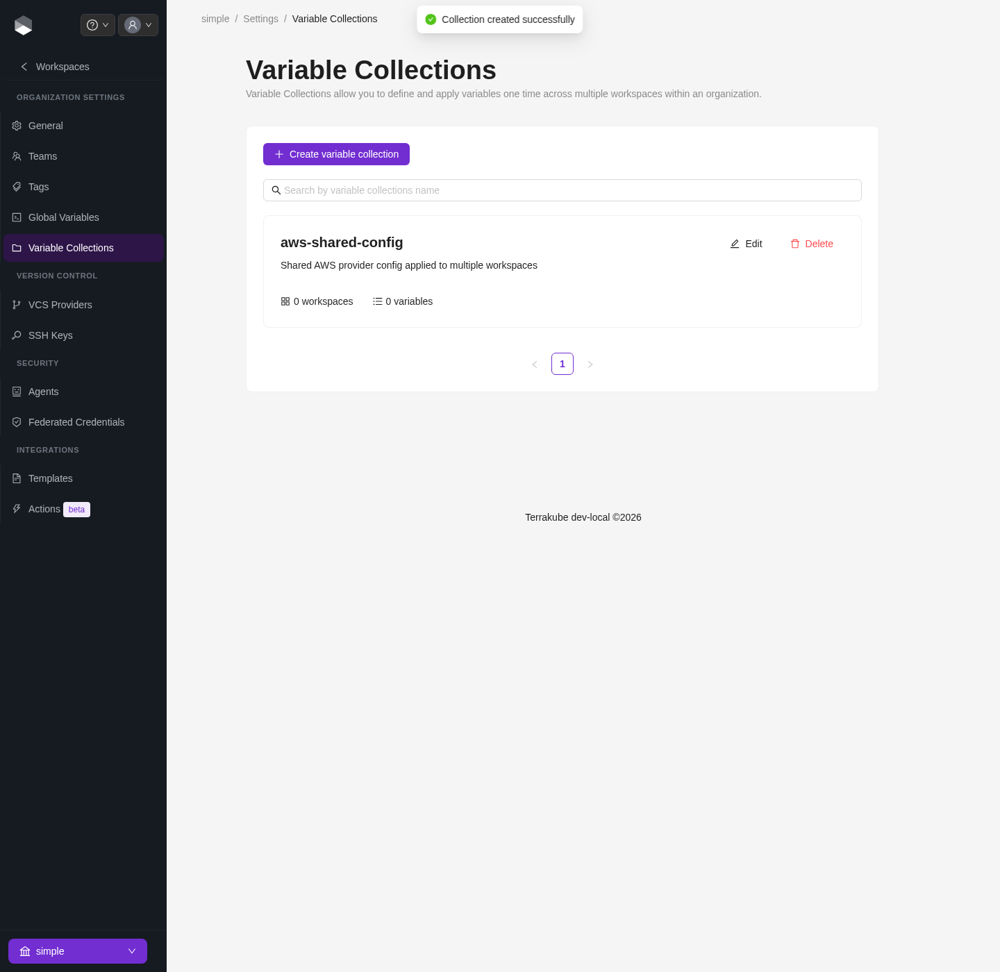
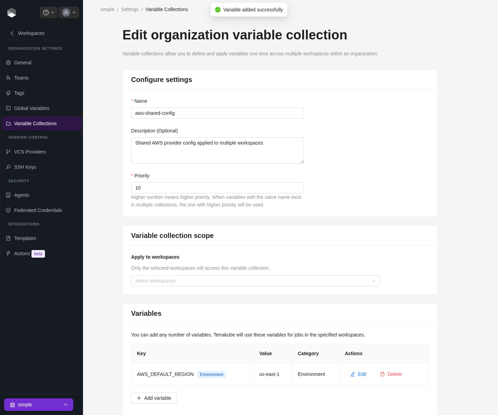

# Variable Collections

A **variable collection** is a named, reusable set of variables at the organization level that you can apply to any number of workspaces — similar to a "variable set" in other Terraform automation tools. Instead of copying the same provider config, tags, or environment variables into every workspace, define them once in a collection and attach it to whichever workspaces need it.

Manage collections from **Organization Settings > Variable Collections**.


Managing collections requires the **Manage Collections** permission. See [Team Management](team-management.md).


<figure><figcaption>
A newly created variable collection, before any variables are added
</figcaption></figure>

### Creating a collection

1. Click **New collection**, give it a **name**, an optional **description**, and a **priority** (see [Resolution order](#resolution-order) below).
2. Optionally select workspaces under **Apply to workspaces** to attach the collection immediately — you can also attach or remove workspaces later.
3. Save the collection, then add variables to it.

### Variables in a collection

Each item in a collection has the same shape as a regular workspace variable:

| Field       | Description                                                        |
| ----------- | -------------------------------------------------------------------- |
| Key         | Variable name                                                        |
| Value       | Variable value                                                       |
| Category    | `Terraform` (passed as a `-var`) or `Environment` (an env var for the run) |
| Sensitive   | Hides the value after saving; cannot be retrieved once set           |
| HCL         | Whether the value should be parsed as HCL instead of a plain string  |
| Description | Optional note                                                        |

<figure><figcaption>
A collection with one environment variable added
</figcaption></figure>

### Attaching a collection to workspaces

On the collection's edit page, the **Apply to workspaces** field under **Variable collection scope** picks which workspaces the collection applies to. Only the workspaces selected there receive the collection's variables — removing a workspace from this list detaches the collection without deleting the collection or its variables.

### Attaching a collection to a project or the whole organization

From Terrakube 2.35 a collection can also be attached to every workspace in a **project**, or to every workspace in the **organization**, so shared settings are defined once.

* **Project**: open the project, go to the **Variables** tab, choose a collection and click **Attach**. Everyone with access to the project can see which collections are attached.
* **Organization**: create a collection reference with `scope` set to `ORGANIZATION` through the API, the Terraform provider (`terrakube_collection_reference` with `scope = "ORGANIZATION"`) or the CLI (`terrakube collection-reference create --scope ORGANIZATION`). Organization wide attachments are deliberately explicit, so a missing workspace can never apply a collection to everything.

Attaching a collection needs the **Manage Collections** permission. A project cannot be deleted while collections are attached to it; detach them first.

### Resolution order

When a job runs, variables are resolved in this order, with earlier sources winning on key conflicts:

1. **Workspace variables**: set directly on the workspace
2. **Organization global variables**: see [Global Variables](global-variables.md)
3. **Collections attached to the workspace**, highest **priority** first
4. **Collections attached to the workspace's project**, highest priority first
5. **Collections attached to the organization**, highest priority first

The narrower the scope, the higher it ranks: a collection attached to a workspace beats one attached to its project, regardless of priority, and priority only decides between collections at the same scope.


A variable collection can never override a workspace-level or global variable with the same key. It only fills in keys that aren't already set. Use priority to control conflicts **between** collections at the same level.


### Sensitive values in 2.34.0

A sensitive collection item cannot be changed back to non-sensitive. Changing the sensitive flag still requires management permission. This prevents previously hidden values from being exposed by clearing the flag. If you need a non-sensitive replacement, create it deliberately with a value suitable for disclosure.
