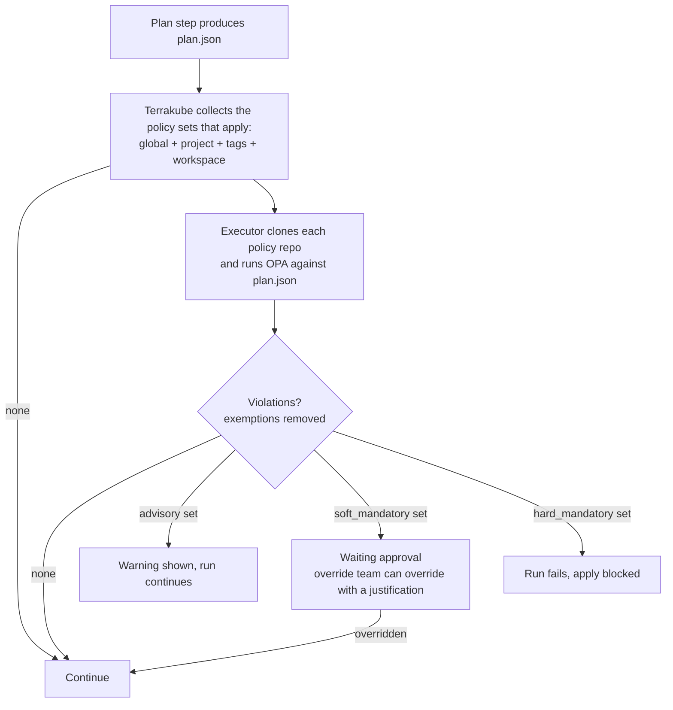
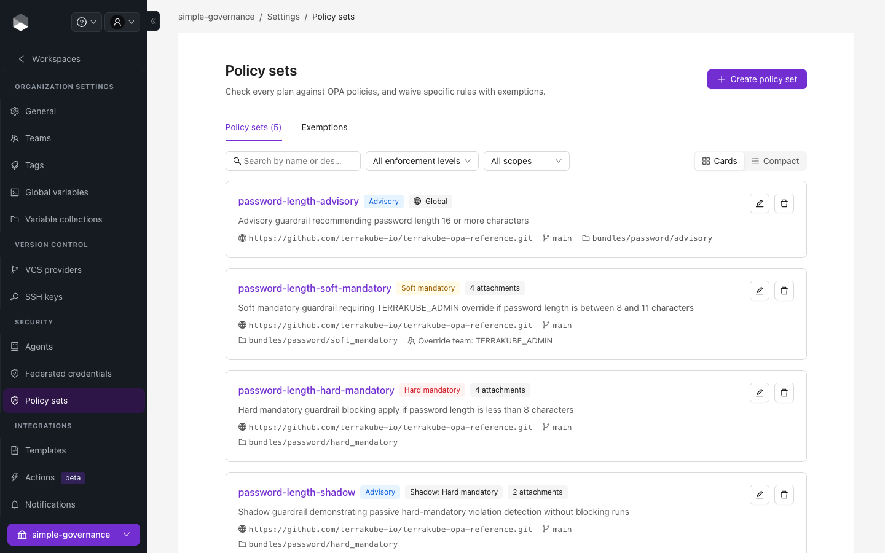
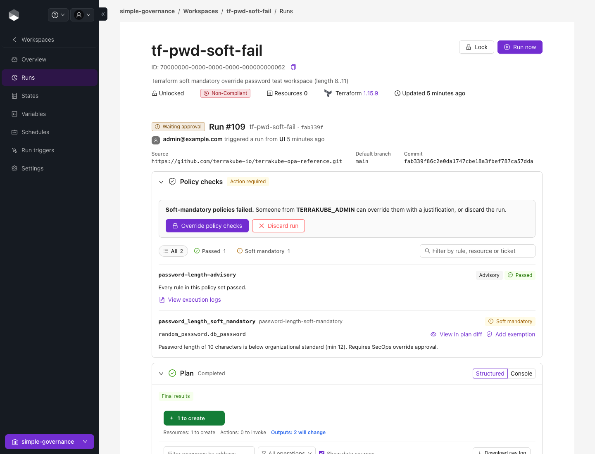
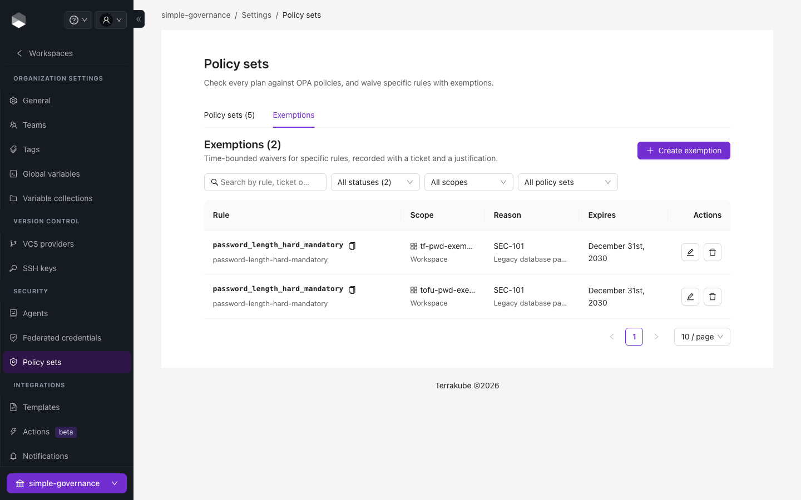
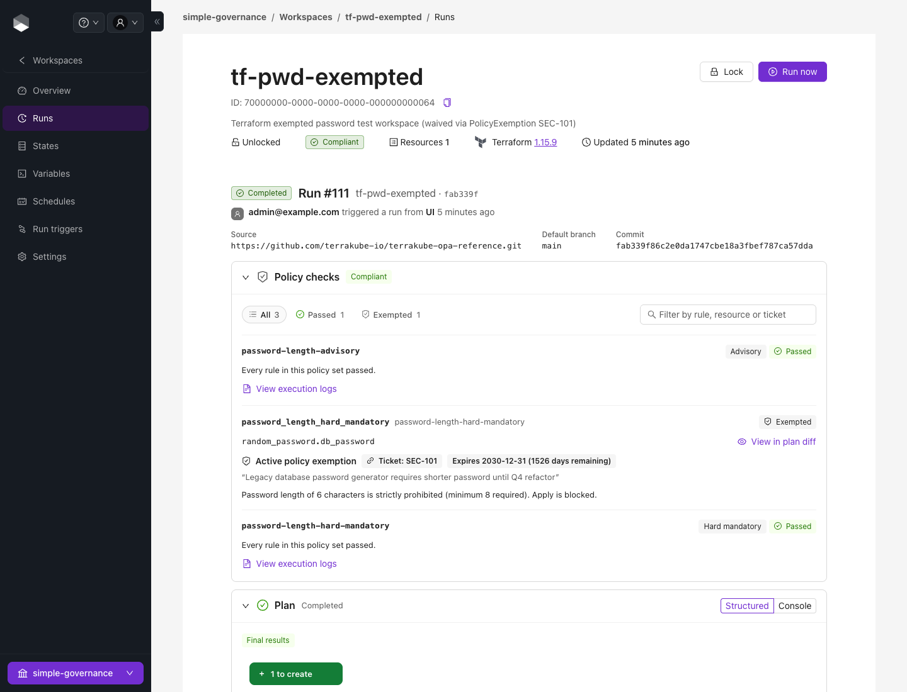

# Policy Governance (OPA)

Policy Governance lets a security team write [Open Policy Agent](https://www.openpolicyagent.org/) (Rego) policies once, store them in Git, and have Terrakube enforce them on every run. Policies are evaluated inside the runner against the plan (`plan.json`) **before** apply, and developers cannot remove them by editing workspace code or a template.


Available from Terrakube 2.34.0. The older, template-based approach is still documented in [Template-based OPA checks](policy-enforcement-opa-templates.md).


### How it fits together

1. A **policy set** points at a folder of Rego in a Git repository and has an **enforcement level**.
2. The policy set is **attached** to the workspaces it governs: the whole organization (global), a project, a tag, or one workspace.
3. After `terraform plan`, the executor evaluates every policy set that applies to the workspace. The result decides whether the run continues.

Policy sets are cumulative: a workspace is checked against the global sets, its project's sets, the sets on its tags, and the sets attached to it directly.



### Enforcement levels

| Level | When the policy fails |
| --- | --- |
| `hard_mandatory` | The run fails and apply is blocked. It cannot be bypassed. |
| `soft_mandatory` | The run stops at **Waiting approval**. Members of the policy set's override team can override it with a justification, which is recorded. |
| `advisory` | A warning is shown in the logs and the UI. The run carries on. |

A policy set can also have a **shadow enforcement level**. Violations of the shadow level are counted and shown but never block a run, so you can trial a stricter level before enabling it.

### Write the policies

Put Rego in a repository folder under the package `terraform.analysis`. Terrakube reads three rule sets from it:

```rego
package terraform.analysis

import rego.v1

# deny: a violation. What it does is decided by the policy set's enforcement level
deny contains {"rule_id": "no-public-s3", "resource": r.address, "msg": "S3 buckets must not be public"} if {
    some r in input.resource_changes
    r.type == "aws_s3_bucket_public_access_block"
    r.change.after.block_public_acls == false
}

# warn: never blocks, shown as a warning
warn contains {"rule_id": "name-prefix", "resource": r.address, "msg": "Prefer the corp- name prefix"} if {
    some r in input.resource_changes
    r.type == "aws_instance"
    not startswith(r.change.after.tags.Name, "corp-")
}
```

Terrakube reads the `deny` and `warn` rules (`soft_mandatory` is also read and treated like `deny`). A `deny` violation fails the run on a `hard_mandatory` set, stops it for approval on a `soft_mandatory` set, and is only a warning on an `advisory` set. Each entry can be a string or an object with `rule_id`, `resource` and `msg`. Shared helpers can live in a `lib/` folder next to the policy folder and are loaded automatically.

### Create a policy set

Open **Settings → Policy Sets** in an organization and create a set:

| Field | Description |
| --- | --- |
| Name / description | Unique name within the organization. |
| Enforcement level | `hard_mandatory`, `soft_mandatory` or `advisory`. |
| Override team | Team allowed to override `soft_mandatory` violations. Organization admins can always override. |
| VCS, repository, branch, folder | Where the Rego lives. Pin `branch` to a release tag (for example `v2.1.0`) to roll policy changes out deliberately. |
| OPA version | Optional. Defaults to the version configured on the executor. |
| Global | Apply to every workspace in the organization. |

Non-global sets are attached to a workspace, project or tag from the same page.

<figure><figcaption><p>Policy sets in an organization, with enforcement level and scope</p></figcaption></figure>


**Parameters** let one bundle be configured per set. They are available to Rego as `data.terrakube.inputs.<key>`, and values are typed (numbers, booleans and JSON are parsed).

Users need the **Manage Policies** team permission to create or change policy sets and exemptions.

### Review a run

Open the run and select the **Policy checks** tab to see passed rules, warnings and violations grouped by policy set, rule and resource. If a `soft_mandatory` policy blocked the run, an authorized user can override it with a justification (up to 2048 characters). The override is audited, and the run then continues to apply. A run with unresolved violations cannot be approved.

<figure><figcaption><p>A soft-mandatory violation waiting for an authorized override</p></figcaption></figure>

The same result is posted as a comment and commit status on pull requests for VCS-driven workspaces.

### Exemptions

An exemption waives one rule instead of disabling a whole policy set. Create it under **Settings → Policy Sets → Exemptions** with the policy set, the `rule_id`, a ticket reference, a justification, and optionally an expiry date. It can apply to the organization, a project, or a workspace. 
<figure><figcaption><p>The Exemptions tab</p></figcaption></figure>

Waived violations are logged as `[EXEMPTED]` and a run that was blocked only by them passes.

<figure><figcaption><p>A violation waived by an exemption, with its ticket and expiry</p></figcaption></figure>

### Continuous compliance

A nightly job re-evaluates workspaces so that a new policy set, a changed policy, or an expired exemption surfaces as **non-compliant** without anyone pushing code. The compliance state shows on each workspace.

### Manage policies with Terraform

Policy sets and attachments are resources of the [Terrakube Terraform provider](https://registry.terraform.io/providers/terrakube-io/terrakube/latest/docs), which is the recommended way to roll the same policies out to many organizations:

```hcl
resource "terrakube_policy_set" "blast_radius" {
  organization_id   = var.organization_id
  name              = "blast-radius"
  enforcement_level = "soft_mandatory"
  override_team     = "secops-approvers"
  global            = true
  vcs_id            = var.vcs_id
  repository        = "https://github.com/acme/terrakube-policies.git"
  branch            = "v2.1.0"
  folder            = "bundles/common/blast_radius"
}

resource "terrakube_policy_attachment" "payments" {
  policy_set_id = terrakube_policy_set.blast_radius.id
  project_id    = var.payments_project_id
}
```

`terrakube_policy_set_parameter` and `terrakube_policy_exemption` are also available.
