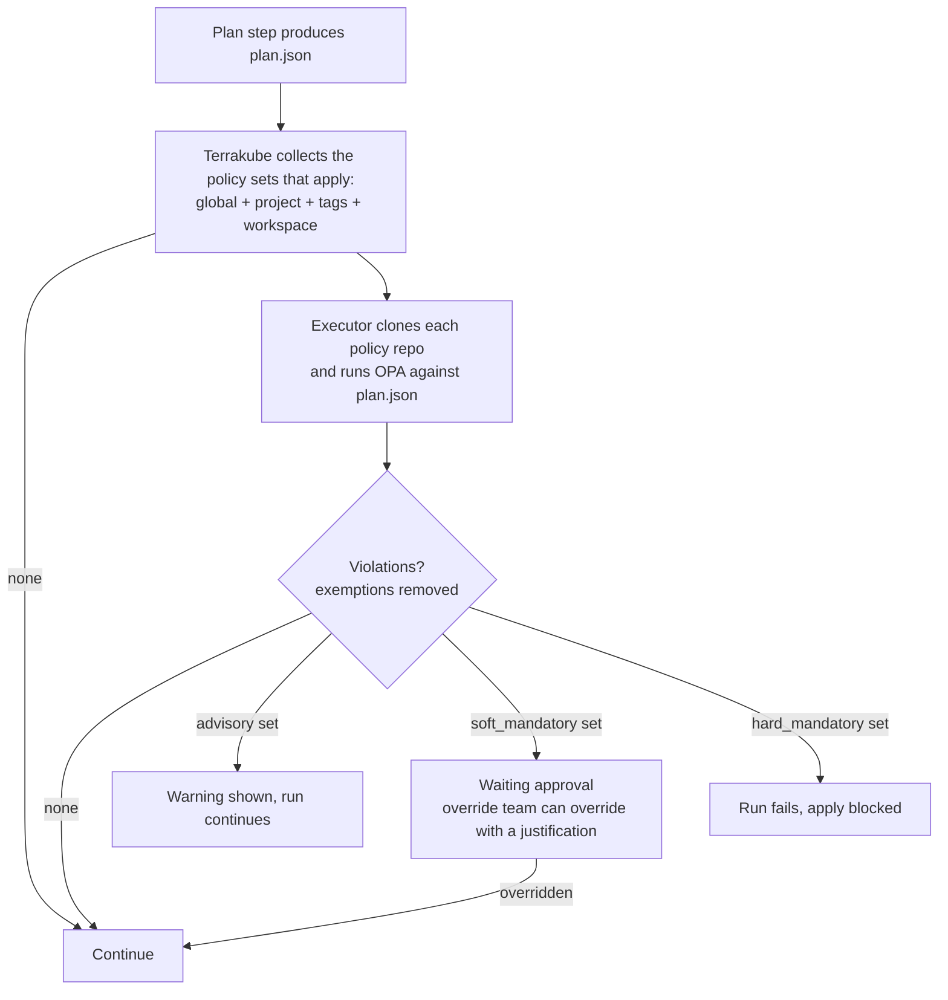

# Policy Governance (OPA)

Policy Governance lets a security team write [Open Policy Agent](https://www.openpolicyagent.org/) (Rego) policies once, store them in Git, and have Terrakube enforce them on every run. Policies are evaluated inside the runner against the plan (`plan.json`) **before** apply, and developers cannot remove them by editing workspace code or a template.


Available from Terrakube 2.34.0. The older, template-based approach is still documented in [Template-based OPA checks](policy-enforcement-opa-templates.md).


### How it fits together

1. A **policy set** points at a folder of Rego in a Git repository and has an **enforcement level**.
2. The policy set is **attached** to the workspaces it governs: the whole organization (global), a project, a tag, or one workspace.
3. After `terraform plan`, the executor evaluates every policy set that applies to the workspace. The result decides whether the run continues.

Policy sets are cumulative: a workspace is checked against the global sets, its project's sets, the sets on its tags, and the sets attached to it directly.

### Start from the reference repository

[`terrakube-io/terrakube-opa-reference`](https://github.com/terrakube-io/terrakube-opa-reference) is a working example of a policy repository: a layout to copy, shared helper libraries, ready-made bundles, unit tests with plan fixtures, and live example workspaces for every outcome. Fork it, keep what you need, and point your policy sets at your fork.

```text
terrakube-opa-reference/
├── lib/        shared Rego helpers (plan parsing, tags, networking, blast radius)
├── bundles/    one folder per policy set: common/, password/, aws/, azure/, gcp/
├── fixtures/   sample `terraform show -json` plans for tests
└── examples/   live Terraform and OpenTofu workspaces that trigger each outcome
```

| Bundle | Level | What it does |
| --- | --- | --- |
| `bundles/common/tagging` | `advisory` | Warns when `Environment`, `Owner` or `CostCenter` tags are missing. |
| `bundles/common/blast_radius` | `soft_mandatory` | Pauses for approval on more than 5 deletions or a high weighted risk score. |
| `bundles/common/required_providers` | `hard_mandatory` | Allows only approved provider registries. |
| `bundles/aws`, `azure`, `gcp` `/baseline` | `hard_mandatory` | Cloud security baselines, such as S3 public access blocks and HTTPS-only storage. |
| `bundles/password/*` | all three levels | A cloud-free suite on `random_password`, handy for trying every level without credentials. |

The repository's own [README](https://github.com/terrakube-io/terrakube-opa-reference#readme) explains how to run its tests with OPA and Regal and how to deploy its policy sets to Terrakube with Terraform. To see every outcome working, its `examples/` workspaces run as the `simple-governance` demo organization that Terrakube seeds in the `demo` profile.


The reference repository is for demonstration and evaluation. Its rules and thresholds are illustrations, not a vetted security baseline. Review and test any policy before it enforces production runs.




### Enforcement levels

| Level | When the policy fails |
| --- | --- |
| `hard_mandatory` | The run fails and apply is blocked. It cannot be bypassed. |
| `soft_mandatory` | The run stops at **Waiting approval**. Members of the policy set's override team can override it with a justification, which is recorded. |
| `advisory` | A warning is shown in the logs and the UI. The run carries on. |

A policy set can also have a **shadow enforcement level**. Violations of the shadow level are counted and shown but never block a run, so you can trial a stricter level before enabling it.

### Write the policies

Put Rego in a repository folder under the package `terraform.analysis`. This follows the [reference repository](https://github.com/terrakube-io/terrakube-opa-reference), which uses a shared `tfplan` helper library:

```rego
package terraform.analysis

import rego.v1
import data.lib.tfplan

# Hard mandatory: a password shorter than 8 characters blocks the apply
deny contains violation if {
    some res in tfplan.resources_by_type("random_password")
    tfplan.is_create_or_update(res)
    len := tfplan.after_or_empty(res).length
    len < 8
    violation := {
        "rule_id": "password_length_hard_mandatory",
        "resource": res.address,
        "message": sprintf("Password length of %d is below the minimum of 8.", [len]),
    }
}
```

Terrakube reads three rule sets from the package: `deny`, `soft_mandatory` and `warn`. **By convention** each bundle uses the rule that matches the level of the policy set it is attached to: `deny` for `hard_mandatory`, `soft_mandatory` for `soft_mandatory` and `warn` for `advisory`. What a violation does is decided by the policy set's enforcement level: on a `hard_mandatory` set it fails the run, on a `soft_mandatory` set it stops the run for approval, and on an `advisory` set it is only a warning. `warn` violations never block.

Each entry can be a string or an object with `rule_id`, `resource` and `message` (`msg` also works). Shared helpers live in a `lib/` folder next to the bundles and are loaded automatically.

**Parameters** let one bundle be configured per policy set without editing Rego. A parameter `min_length` set on the policy set is available as `data.terrakube.inputs.min_length`:

```rego
configured_min_length := to_number(data.terrakube.inputs.min_length) if {
    data.terrakube.inputs.min_length != ""
}
```

### Create a policy set

Open **Settings → Policy Sets** in an organization and create a set:

| Field | Description |
| --- | --- |
| Name / description | Unique name within the organization. |
| Enforcement level | `hard_mandatory`, `soft_mandatory` or `advisory`. |
| Override team | Team allowed to override `soft_mandatory` violations. Organization admins can always override. |
| VCS, repository, branch, folder | Where the Rego lives. Pin `branch` to a tag in your policy repository to roll policy changes out deliberately. |
| OPA version | Optional. Defaults to the version configured on the executor. |
| Global | Apply to every workspace in the organization. |

Non-global sets are attached to a workspace, project or tag from the same page.

<figure><figcaption><p>Policy sets in an organization, with enforcement level and scope</p></figcaption></figure>


Set parameters on the policy set. Their values are typed: numbers, booleans and JSON are parsed.

Users need the **Manage Policies** team permission to create or change policy sets and exemptions.

### Review a run

Open the run and select the **Policy checks** tab to see passed rules, warnings and violations grouped by policy set, rule and resource. If a `soft_mandatory` policy blocked the run, an authorized user can override it with a justification (up to 2048 characters). The override is audited, and the run then continues to apply. A run with unresolved violations cannot be approved.

<figure><figcaption><p>A soft-mandatory violation waiting for an authorized override</p></figcaption></figure>

The same result is posted as a comment and commit status on pull requests for VCS-driven workspaces.

### Exemptions

An exemption waives one rule instead of disabling a whole policy set. Create it under **Settings → Policy Sets → Exemptions** with the policy set, the `rule_id`, a ticket reference, a justification, and optionally an expiry date. It can apply to the organization, a project, or a workspace. 
<figure><figcaption><p>The Exemptions tab</p></figcaption></figure>

Waived violations are logged as `[EXEMPTED]` and a run that was blocked only by them passes.

<figure><figcaption><p>A violation waived by an exemption, with its ticket and expiry</p></figcaption></figure>

### Continuous compliance

A nightly job re-evaluates workspaces so that a new policy set, a changed policy, or an expired exemption surfaces as **non-compliant** without anyone pushing code. The compliance state shows on each workspace.

### Manage policies with Terraform

Policy sets and attachments are resources of the [Terrakube Terraform provider](https://registry.terraform.io/providers/terrakube-io/terrakube/latest/docs), which is the recommended way to roll the same policies out to many organizations:

```hcl
resource "terrakube_policy_set" "blast_radius" {
  organization_id   = var.organization_id
  name              = "blast-radius"
  enforcement_level = "soft_mandatory"
  override_team     = "secops-approvers"
  global            = true
  vcs_id            = var.vcs_id
  repository        = "https://github.com/acme/terrakube-opa-reference.git" # your fork
  branch            = "main"
  folder            = "bundles/common/blast_radius"
}

resource "terrakube_policy_attachment" "payments" {
  policy_set_id = terrakube_policy_set.blast_radius.id
  project_id    = var.payments_project_id
}
```

`terrakube_policy_set_parameter` and `terrakube_policy_exemption` are also available.
