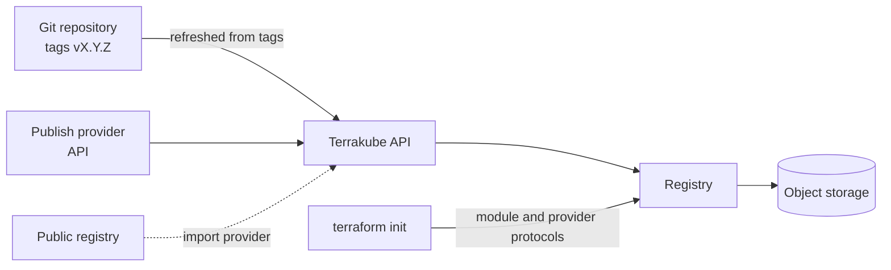

# Private Registry

Terraform provides a public registry, where you can share and reuse your terraform modules or providers, but sometimes you need to define a Terraform module that can be accessed only within your organization.

Terrakube provides a private registry that works similarly to the [public Terraform Registry](https://developer.hashicorp.com/terraform/registry) and helps you share [Terraform providers](https://developer.hashicorp.com/terraform/language/providers) and [Terraform modules](https://developer.hashicorp.com/terraform/language/modules) privately across your organization. You can use any of the main [VCS providers](../vcs-providers/) to maintain your terraform module code.


The Terrakube UI publishes [private modules](publishing-private-modules.md). You can add providers from the public registry in the UI, or publish your own with the [Terrakube API](../../api/methods/provider.md).


Modules are published from a git repository: each semantic version tag becomes a module version. Providers are imported from the public registry or uploaded through the API. Terraform and OpenTofu then install both through the standard registry protocols after logging in.

In this section:


[publishing-private-modules.md](publishing-private-modules.md)



[using-private-modules.md](using-private-modules.md)



[deprecating-and-removing-versions.md](deprecating-and-removing-versions.md)


### New versions appear after a refresh

Terrakube reads a module's git tags every 5 minutes and the registry caches the version list for 10 minutes. To shorten the delay, set `ModuleRefreshInterval` (API, seconds, default `300`) and `ModuleVersionsCacheTtlSeconds` (registry, seconds, default `600`). Setting both to `30` brings a new tag into the registry in about a minute.
