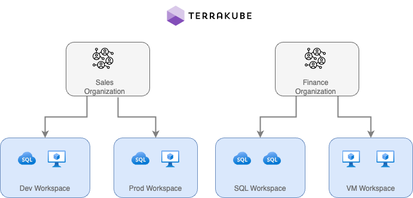
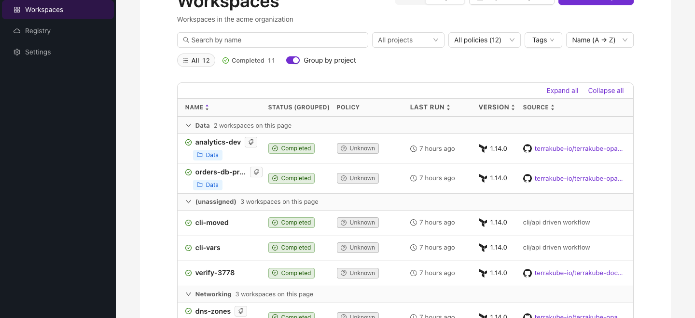
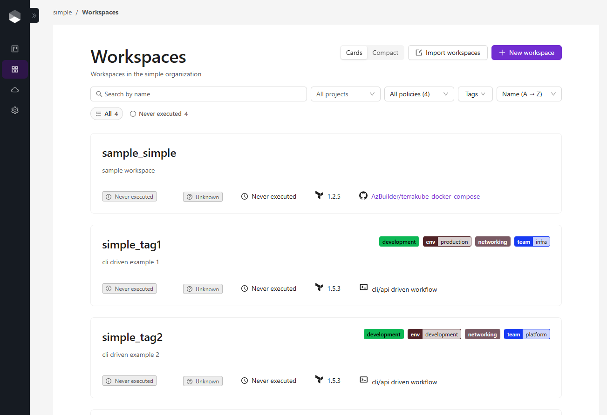
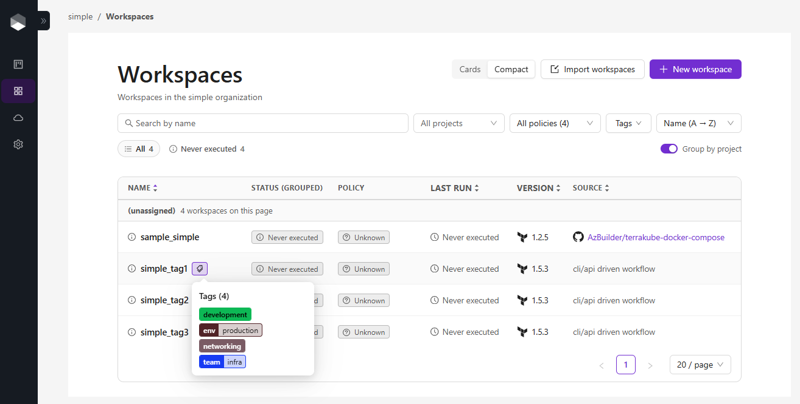
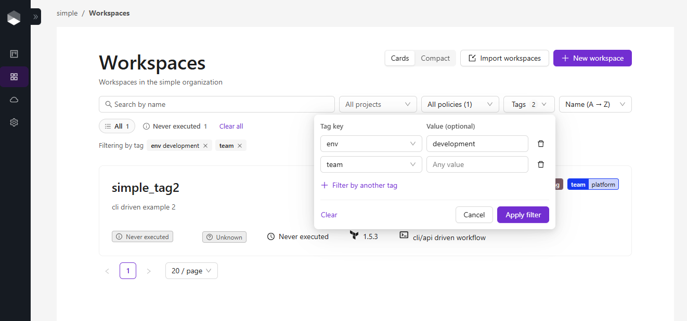

# Workspaces

When working with Terraform at Enterprise level, you need to organize your infrastructure in different collections. Terrakube manages infrastructure collections with **workspaces**. A workspace contains everything Terraform needs to manage a given collection of infrastructure, so you can easily organize all your resources based in your requirements.

For example, you can create a workspace for dev environment and a different workspace for production. Or you can separate your workspaces based in your resource types, so you can create a workspace for all your SQL Databases and anothers workspace for all your VMS.

<figure><figcaption></figcaption></figure>

You can create unlimited workspaces inside each Terrakube Organization.

### Workspaces list

<figure><figcaption>
The Workspaces list, grouped by project
</figcaption></figure>

The **Workspaces** page has two views, toggled in the top right and remembered per browser:

* **New** — a condensed list with click-to-filter tags and project chips, an optional **group by project** mode (each project paginates independently), and a lock indicator per workspace.
* **Legacy** — the original table view.

Use the search box and tag/project filters to narrow a long list; clicking a tag or project chip on any row applies it as a filter directly.

#### Tags in the list

Each tag is shown as a chip with its key and, for a key/value tag, its value (hover a chip to see `key = value`). Tags are sorted by key, then by value. The **Cards** view shows every tag on each card.

<figure><figcaption></figcaption></figure>

In the **Compact** view, a tag icon next to the workspace name opens all of the workspace's tags in a popover on hover, click or keyboard focus.

<figure><figcaption></figcaption></figure>

#### Filtering by tag

Click **Tags** in the filter bar to open the tag filter. It takes one or more rows, each with a **tag key** and an optional **value**; click **Filter by another tag** to add a row:

* A row with a value matches workspaces where that key has exactly that value, for example `env = development`.
* A row without a value matches every workspace that has the key, whatever its value.
* Several rows are combined with AND, so `env = development` and `team = platform` matches only the workspaces that have both.

Click **Apply filter** to apply the rows, or **Clear** in the tag filter popover to remove just the tag filters.

<figure><figcaption></figcaption></figure>

In this section:

### In this section

**Set up**: [Creating Workspaces](creating-workspaces.md), [Overview](overview.md), [Variables](variables.md), [Team Access](team-access.md)

**Run**: [Starting a Run](starting-a-run.md), [Webhooks](webhooks.md), [Workspace scheduler](workspace-scheduler.md), [Run Triggers](run-triggers.md), [Job Output](job-output.md), [Notifications](notifications.md)

**Workflows**: [CLI-driven](cli-driven-workflow.md), [API-driven](api-driven-workflow.md), [Ephemeral Workspaces](ephemeral-workspaces.md)

**State and caching**: [Terraform State](terraform-state.md), [Share Workspace State](share-workspace-state.md), [Provider Cache](provider-cache.md), [Module Cache](module-cache.md), [Plan Artifacts](plan-artifacts.md)

**Credentials and extensions**: [Dynamic Provider Credentials](dynamic-provider-credentials/README.md), [Actions](actions/README.md)
