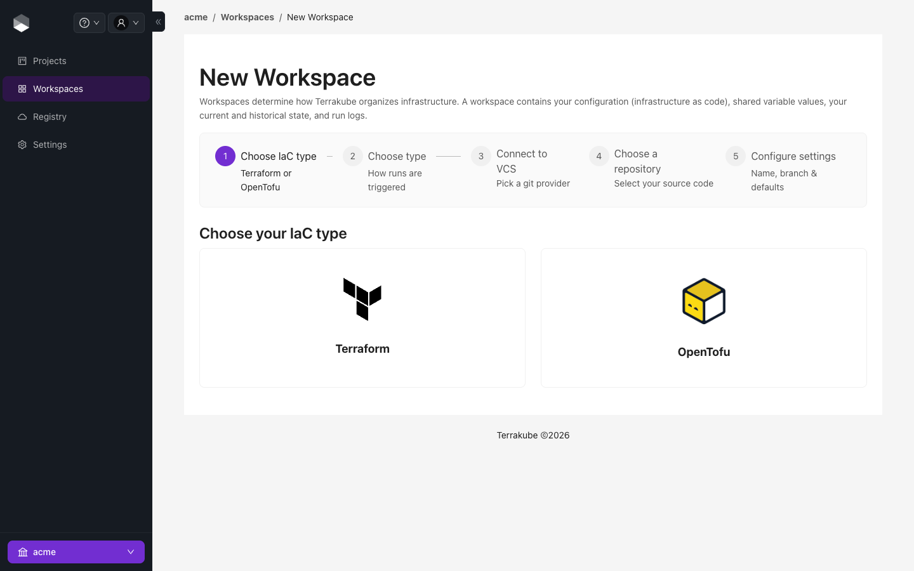
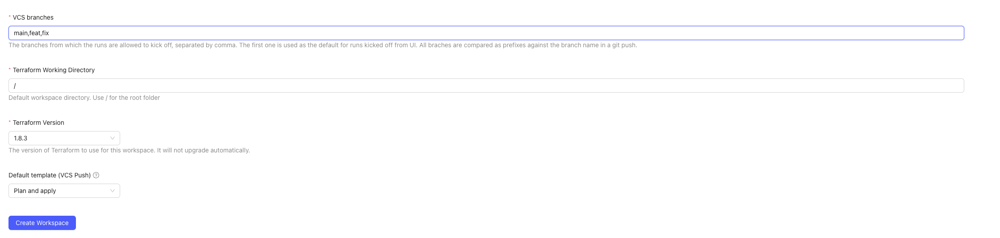
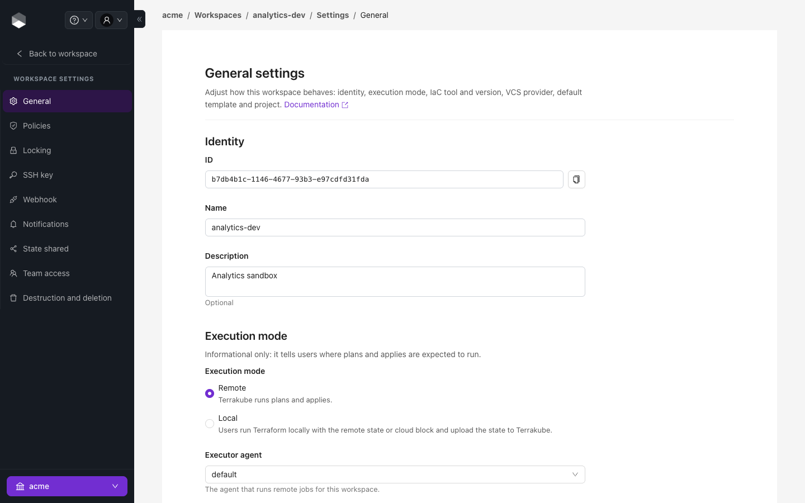

# Creating Workspaces


**Manage Workspaces** permission is required to perform this action, please check [team-management.md](../organizations/team-management.md "mention") for more info.


When creating a Workspace, Terrakube supports 3 workflows types and based on the selected workflow you will need to provide some parameters. Please refer to each workflow section for more reference.

* [Version Control workflow](creating-workspaces.md#version-control-workflow): Store your Terraform configuration in a git repository, and trigger runs based on pull requests and merges.
* [CLI-driven workflow](creating-workspaces.md#cli-driven-workflow): Trigger remote Terraform runs from your local command line.
* [API-driven workflow](creating-workspaces.md#api-driven-workflow): A more advanced option. Integrate Terraform into a larger pipeline using the [Terrakube API](../../api/getting-started.md).

<figure><figcaption>
The New Workspace wizard
</figcaption></figure>

### Version Control workflow

Click **Workspaces** in the main menu and then click the **New workspace** button

Select the IaC type for now we support terraform and open tofu

Choose the **Version control workflow**

Select an existing version control provider or click **Connect to a different VCS** to configure a new one. See [vcs-providers](../vcs-providers/ "mention") for more details.

For GitHub (OAuth or App), GitLab, Bitbucket, and Azure DevOps connections, search and pick a repository from a paginated list backed by the provider's API instead of typing a URL — this scales to organizations with thousands of repositories. Select one and click **Continue**.


SSH connections don't support repository discovery, since there's no provider API to query — provide the git repository URL directly, in SSH format. Example git@github.com:jcanizalez/terraform-sample-repository.git. For more information see [ssh.md](../vcs-providers/ssh.md "mention")


Configure the workspace settings.

| Field                       | Description                                                                                                                                                                                                                            |
| --------------------------- | -------------------------------------------------------------------------------------------------------------------------------------------------------------------------------------------------------------------------------------- |
| Workspace Name              | The name of your workspace is unique and used in tools, routing, and UI. Dashes, underscores, and alphanumeric characters are permitted.                                                                                               |
| VCS branch                  | A list of branches separated by comma that jobs are allowed to kicked off from VCS webhook. This is not used for CLI workflow.                                                                                                         |
| Terraform Working Directory | Default workspace directory. Use / for the root folder                                                                                                                                                                                 |
| Terraform Version           | The version of Terraform to use for this workspace, or a version constraint (`~> 1.5`, `^1.5.0`, `1.5.x`, `>= 1.5, < 2.0`, etc.) to resolve to the latest matching version instead of pinning an exact one. Check [custom-terraform-cli-builds.md](../../getting-started/deployment/custom-terraform-cli-builds.md "mention") if you want to restrict the versions in your Terrakube instance. |

Once you fill the settings click the **Create Workspace** button.

<figure><figcaption></figcaption></figure>

When using a VCS workflow you can select which branches, folder and action (aka, Default template (VCS push)) the runs will be triggered from when a git push action happens.

The `VCS branches` accepts a list of branches separated by comma, the first in the list is used as the default for the runs kicked off from UI. The branches are compared as prefixes against the branch included in the payload sent from VCS provider.

You will be redirected to the Workspace page

And if you navigate to the **Workspace** menu, you will see the workspace in the Workspaces list

Once you create your workspace, Terrakube sets up a webhook with your VCS. This webhook runs a job based on the selected template every time you push new changes to the set workspace branches. See [webhooks.md](webhooks.md "mention") for how to configure additional events (pull requests, releases) and the PR comment workflow.

### CLI-driven Workflow

Click **Workspaces** in the main menu and then click the **New workspace** button

Choose the **CLI-driven workflow**

Configure the workspace settings.

| Field             | Description                                                                                                                                                                                                                            |
| ----------------- | -------------------------------------------------------------------------------------------------------------------------------------------------------------------------------------------------------------------------------------- |
| Workspace Name    | The name of your workspace is unique and used in tools, routing, and UI. Dashes, underscores, and alphanumeric characters are permitted.                                                                                               |
| Terraform Version | The version of Terraform to use for this workspace. Check [custom-terraform-cli-builds.md](../../getting-started/deployment/custom-terraform-cli-builds.md "mention") if you want to restrict the versions in your Terrakube instance. |

Once you fill the settings click the **Create Workspace** button.

You will be redirected to the Workspace page.


The overview page for CLI-driven workspaces show the step to connect to the workspace using the Terraform CLI. For more details see [cli-driven-workflow.md](cli-driven-workflow.md "mention")


And if you navigate to the **Workspace** menu you will see the workspace in the Workspaces list

### API-driven Workflow

Click **Workspaces** in the main menu and then click the **New workspace** button

Choose the **API-driven workflow**

Configure the workspace settings.

| Field             | Description                                                                                                                                                                                                                            |
| ----------------- | -------------------------------------------------------------------------------------------------------------------------------------------------------------------------------------------------------------------------------------- |
| Workspace Name    | The name of your workspace is unique and used in tools, routing, and UI. Dashes, underscores, and alphanumeric characters are permitted.                                                                                               |
| Terraform Version | The version of Terraform to use for this workspace. Check [custom-terraform-cli-builds.md](../../getting-started/deployment/custom-terraform-cli-builds.md "mention") if you want to restrict the versions in your Terrakube instance. |

Once you fill the settings click the **Create Workspace** button.

ou will be redirected to the Workspace page.


For more details how to use the Terrakube API. See [api-driven-workflow.md](api-driven-workflow.md "mention")


And if you navigate to the **Workspace** menu you will see the workspace in the Workspaces list

### Changing the repository or VCS provider

Under **Settings → General**, a Version Control workspace can be pointed at a different **VCS provider** or **Repository URL**, for example after moving from GitHub to GitLab. State, variables and run history are kept. If the workspace has a [webhook](webhooks.md), Terrakube asks you to confirm and removes it first; enable it again afterwards. The repository field is not shown for CLI-driven workspaces.

<figure><figcaption>
Settings, General
</figcaption></figure>
