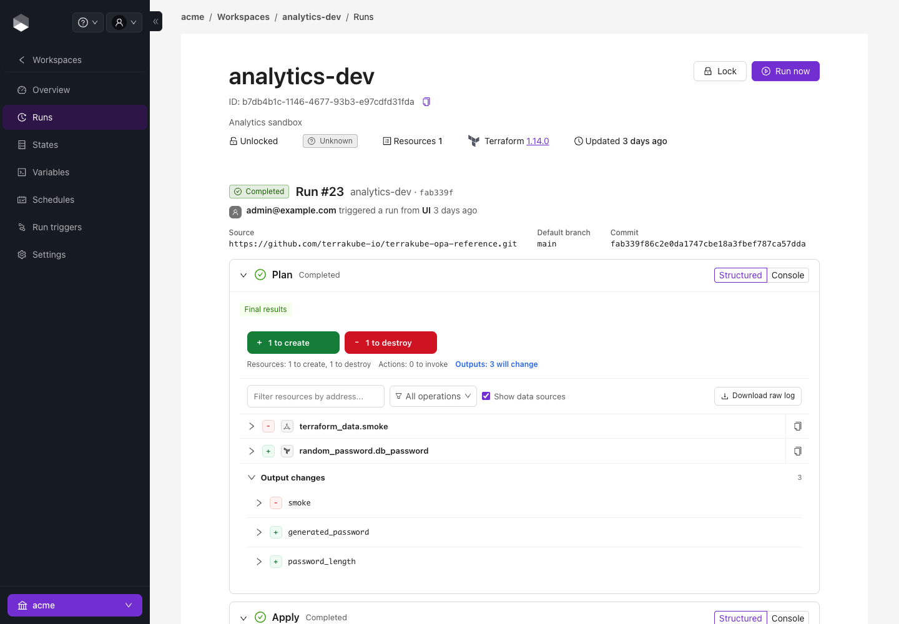
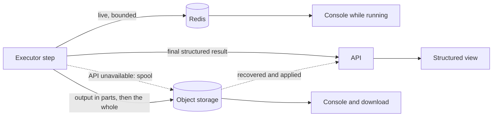

# Job Output

Each plan, apply and destroy step shows its result two ways, with a **Structured** / **Console** toggle. **Console** is the raw Terraform or OpenTofu output. **Structured** renders the same plan or apply as a resource-by-resource change list, with filtering, diffs and diagnostics.

<figure><figcaption>
A plan step in the Structured view
</figcaption></figure>

### The structured view

Each resource shows:

* An **action** badge: `create`, `update`, `delete`, `replace` (destroy and create), `import` or `no-op`.
* The attributes that change, with unchanged attributes collapsed (expanded for imports, where you usually want to check what already matches).
* A provider icon next to the resource address.

Use **filter resources by address** and the **operation filter** (multi-select, with a count per operation) to narrow a large plan. A summary line gives the totals, for example "4 to create" and "Outputs: 1 will change".


Sensitive values are redacted before they leave the executor, in both views, not just hidden in the browser.


### Plans

* **Diagnostics.** A panel above the steps lists every error and warning for the run, with the resource address and source location when known. It is built from the run's data, so the resource filters and collapsed rows never hide it, and the same message reported by plan and apply appears once.
* **Output changes.** Terraform reports changes to root module outputs separately from resource changes. When a plan changes only outputs (for example one derived from a data source), an **Output changes** panel shows the diff instead of "no changes".
* **No false "no changes".** A plan that failed shows its error instead of saying nothing changed.

### Applies

During an apply the structured view updates live, per resource, as each change completes. Once it finishes, an **Outputs** section lists the workspace's outputs, with sensitive ones redacted like resource attributes. The apply output starts with the live resource actions; it no longer repeats the plan you already reviewed, which also matches how the Terraform CLI behaves when it runs a [remote apply](cli-driven-workflow.md).

### Is this the final result?

A saved snapshot looks like a finished result, so each plan, apply and destroy step says how far its structured result can be trusted. This is separate from whether the step succeeded:

| What the step shows | What it means |
| --- | --- |
| **Final results** | The final result reached Terrakube, or was recovered from storage. |
| **Recovering final output** | The executor saved the result to storage while the API was unavailable, and the API is about to apply it. |
| **Final output lost** | The result could not be recovered. The last progress that was saved stays visible. |
| **Waiting for final output**, then **Partial results** | The step finished but only a progress snapshot has arrived. The page checks for a while, then says the result is partial. |
| **Output unavailable** | The structured output cannot be read right now and nothing confirms the step. |

Runs from before 2.34 show no notice and look as they did.

### How output is kept safe

The run's result must not depend on the API being reachable at the moment a step ends, so the executor delivers it in layers. **It never runs Terraform or OpenTofu again to recover output.**

What survives each failure:

| What goes wrong | What you still have | What can be lost |
| --- | --- | --- |
| **The API is briefly down** when a step ends | The final structured result is spooled to storage and applied automatically when the API returns (state **Recovering**, then **Final results**). | Nothing. |
| **The executor dies mid-step** | The Console output uploaded so far, in parts, with a notice that it is incomplete, and everything the API already had. | The output printed since the last uploaded part; the final structured snapshot if it was never delivered or spooled. |
| **A step ends normally** | The complete Console output and the final structured result. | Nothing. |

A spooled result is kept for 24 hours by default. Recovery needs a storage backend that both the executor and the API can read (S3, Azure Blob, Google Cloud Storage, or a shared local directory); with executor-only local storage nothing can be recovered after the executor is gone. See [Executor Log Output](../../getting-started/deployment/executor-log-output.md) for the settings.

### Pull request comments

For a [webhook](webhooks.md) run, the plan is posted on the pull request. The text published for the comment is bounded (48 KiB by default), so a plan with a very large diff is cut with a closing note ("N more lines of the plan are not shown here. The full plan is in the output of this step in Terrakube.") and the full diff stays in the step output. Terrakube also streams the plan as it prints instead of holding it all in memory, which keeps executors stable on huge plans. Raise or lower the limit with `ExecutorLogsRenderedPlanContextMaxBytes`.

### Limits

The live log is bounded so a very noisy provider cannot exhaust memory. Lines over 64 KiB are shortened in the live view only; the Console after the step and the download always contain the full text. Output beyond 4 MiB per step moves to a temporary file on the executor instead of staying in memory.

### Related

* [Run Lifecycle](../../concepts/run-lifecycle.md): where output and state fit into a run.
* [Executor Log Output](../../getting-started/deployment/executor-log-output.md): every setting, for operators.
* [Troubleshooting](../reference/troubleshooting.md#logs-are-missing-or-the-console-says-output-is-incomplete).
