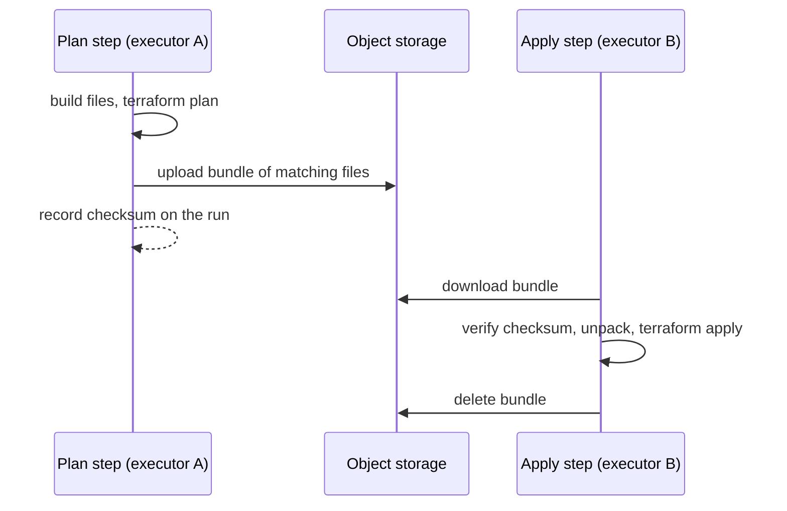

# Plan Artifacts

Plan and apply run in separate clones, usually on different executors. A file the plan step built, such as a Lambda zip from `data "archive_file"` or a Helm chart, would not exist in the apply step, and the resource that refers to it fails with "no such file or directory". **Plan artifacts** copy those files from plan to apply.


Available from Terrakube 2.34.0. It is opt-in: a workspace that does not configure it behaves as before.


If you can, build the package once in CI and reference it by S3 key and hash instead; then nothing has to be carried.



### Choose the files

List globs on the plan step of a [template](../organizations/templates/README.md):

```yaml
flow:
  - type: terraformPlan
    step: 100
    artifacts:
      - "build/*.zip"
  - type: terraformApply
    step: 200
```

Or set the `TERRAKUBE_PLAN_ARTIFACTS` environment variable on a workspace or organization, which replaces the template's list (an empty value turns it off). Separate patterns with commas or new lines.

* Patterns are relative to the working directory and use Java glob syntax: `*` stays in a directory, `**` crosses directories.
* `${VAR}` is replaced from the run's environment variables; a pattern using an unset variable is dropped.
* A pattern that matches nothing **fails the plan**. Prefix it with `optional:` if that is expected.
* `.git`, `.terraform`, credential files, the plan file, `plan.json`, policy inputs and symbolic links are never packaged.
* Use relative paths such as `${path.root}/build/report.zip` in Terraform. `path.cwd` and `abspath()` put an absolute path in the plan that will not match.

### What happens

1. After a plan with changes, the executor packs the matching files, stores them, and records the checksum on the run. The plan output lists what was saved. If the files cannot be saved, the plan fails.
2. The apply step downloads the bundle, verifies its checksum, and unpacks it before anything else runs. A missing or mismatched bundle fails the apply.
3. The bundle is deleted after a successful apply and when the run ends.

Limits are `ExecutorArtifactsMaxBytes` (default 512 MiB) and `ExecutorArtifactsMaxFiles` (default 10000) on the executor. Add a storage lifecycle rule on the `plan-artifacts/` prefix as a backstop for runs that Terrakube closes on a timeout.
