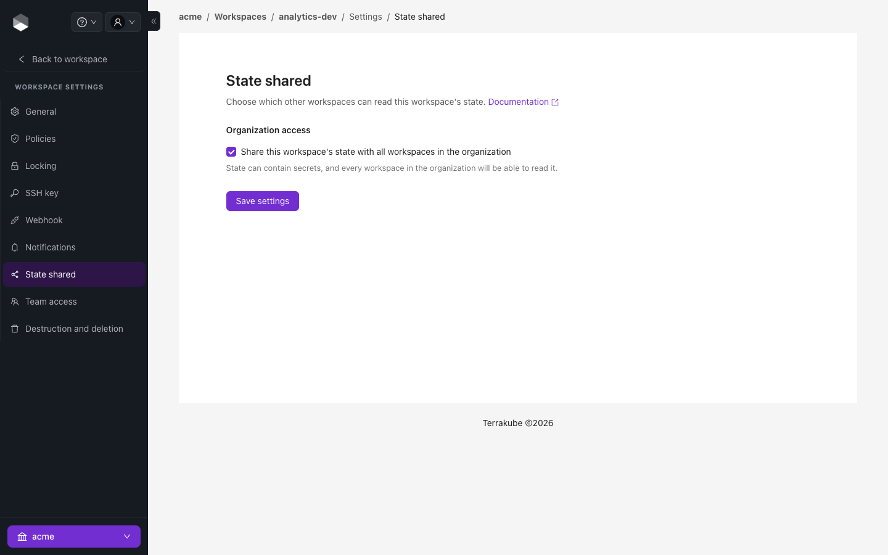

# Share Workspace State

One workspace can read another workspace's outputs with the standard `terraform_remote_state` data source. This is how, for example, an application workspace reads the VPC id exported by a network workspace.

### Allow sharing

State is private by default. In the **producer** workspace open **Settings → State shared** and share it with the workspaces that need it. **Share this workspace's state with all workspaces in the organization** allows every workspace in the organization to read it, so only enable it when the state holds nothing sensitive.

<figure><figcaption><p>Settings, State shared</p></figcaption></figure>

### Read it from another workspace

In the **consumer** configuration use the `remote` backend and point it at your Terrakube hostname, organization and the producer workspace:

```hcl
data "terraform_remote_state" "network" {
  backend = "remote"
  config = {
    hostname     = "terrakube-api.example.com"
    organization = "simple"
    workspaces = {
      name = "network"
    }
  }
}

resource "aws_instance" "app" {
  subnet_id = data.terraform_remote_state.network.outputs.subnet_id
}
```

Only root-module **outputs** of the producer are readable. If the producer should trigger the consumer when it changes, add a [run trigger](run-triggers.md).


Supported from Terrakube 2.15.0.

